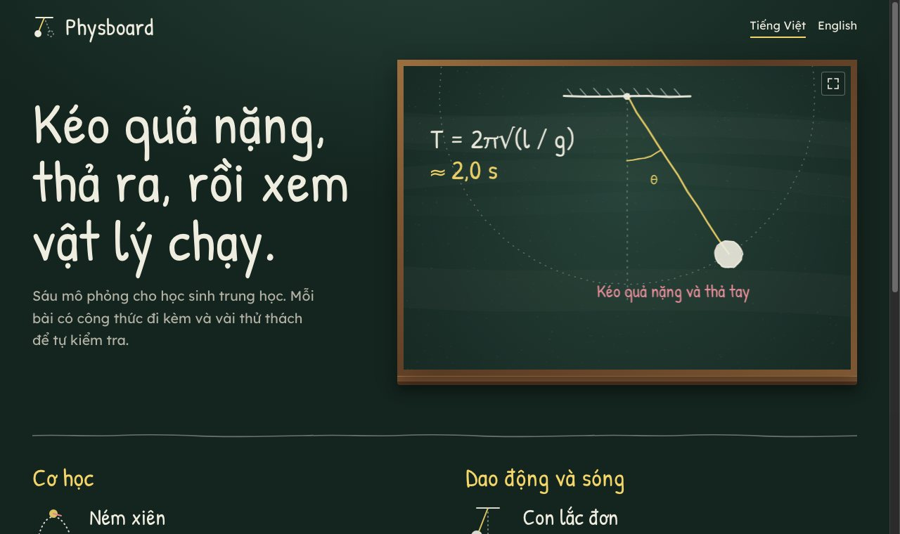
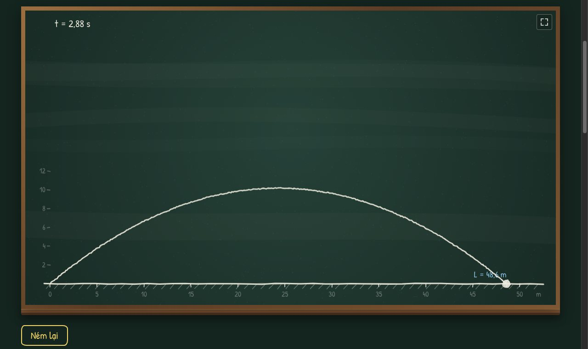
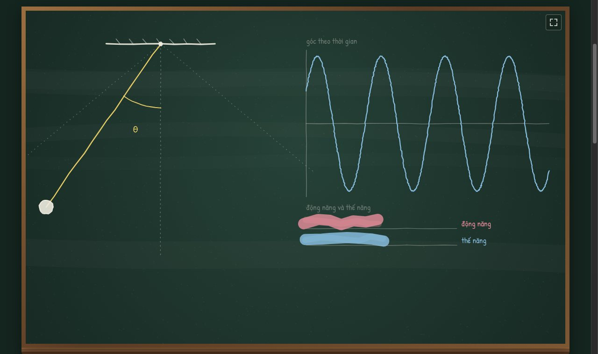
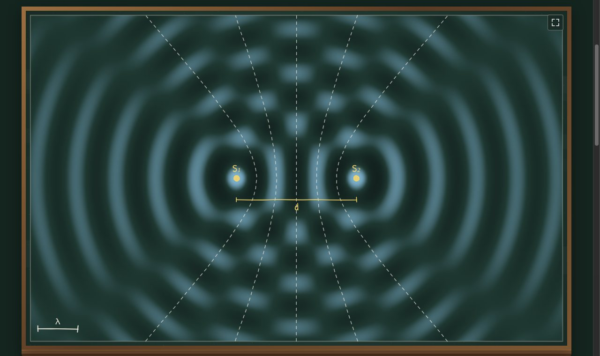
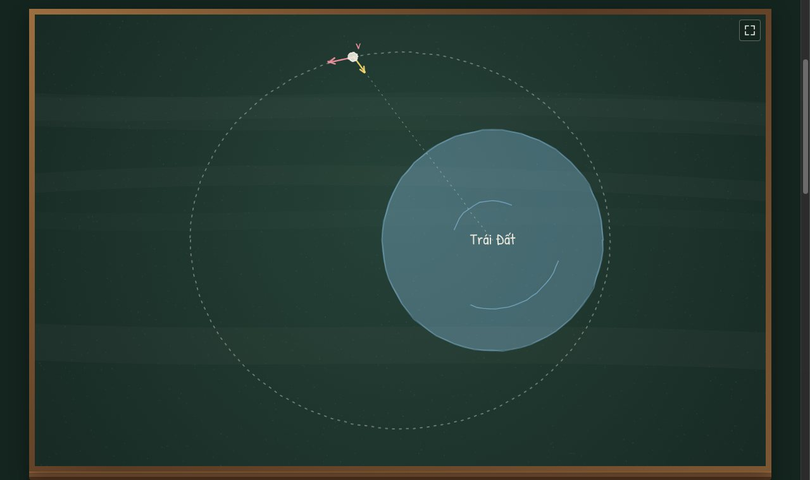
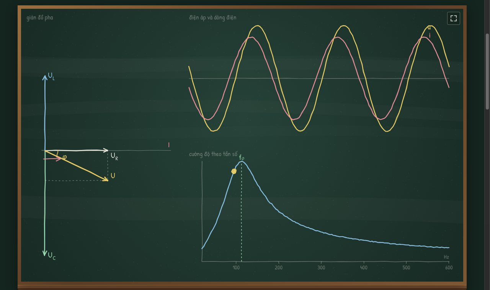
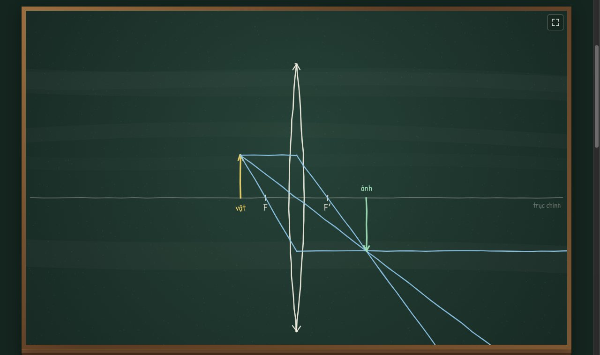
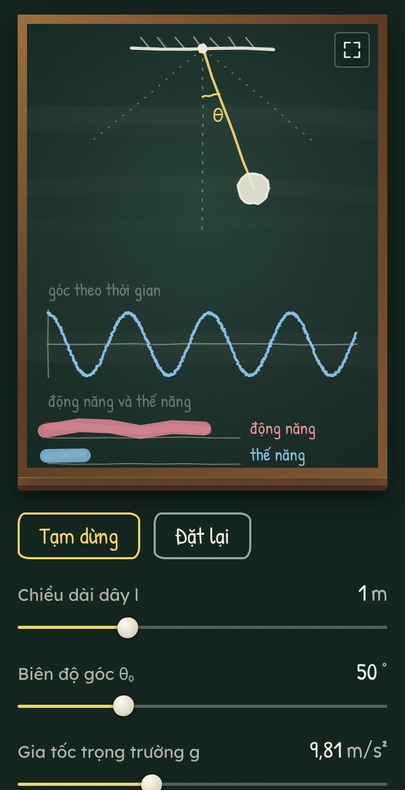

# Physboard

🌐 **Live:** https://physboard.web.app

Interactive physics simulations for high-school students, in **Vietnamese and English**. Drag the weight, change the numbers, and watch the physics run.

| Simulation | Topic |
| --- | --- |
| Projectile motion | Mechanics: launch angle, speed, gravity (Moon to Jupiter) and air drag |
| Satellite orbits | Mechanics: circular, elliptical and escape orbits, with Kepler's third law |
| Simple pendulum | Oscillations: drag the bob, measure the period, see why large swings are slower |
| Wave interference | Waves: two sources, maxima and minima, in-phase and out-of-phase |
| Series RLC circuit | Electricity: phasor diagram, waveforms and the resonance curve |
| Thin lens | Optics: ray diagram for converging and diverging lenses, real and virtual images |

Each page has live measurements, the formulas behind them, a short explanation, and three numeric challenges that load their own preset into the simulation and check your answer.

## Screenshots

| Home: the pendulum you can pick up | Projectile motion |
| --- | --- |
|  |  |

| Simple pendulum | Wave interference |
| --- | --- |
|  |  |

| Satellite orbits | Series RLC circuit |
| --- | --- |
|  |  |

| Thin lens | On a phone |
| --- | --- |
|  |  |

## Why trust the numbers

The simulations solve the real equations of motion with fourth-order Runge–Kutta, and the physics lives in plain TypeScript modules under [`src/app/physics`](src/app/physics) that know nothing about the UI. They are covered by tests that check physics, not just code:

- a pendulum keeps its energy constant to 1 part in 10⁷ over 30 s, and its measured period matches the exact (elliptic-integral) period at 10°, 60° and 120°;
- an eccentric orbit conserves energy, and the period of an ellipse matches Kepler's third law;
- the time-averaged interference pattern equals the average of the instantaneous wave squared;
- at resonance the reactances cancel, Z = R and φ = 0;
- the thin-lens equation holds, and the textbook cases (2f, inside f, diverging) come out right.

Every challenge's stored answer is recomputed from its preset by the physics code in a test, so the answer and the question cannot drift apart.

## Stack

Angular 21 (standalone components, signals, zoneless) · Tailwind CSS 4 · KaTeX · Vitest · Firebase Hosting

Every page is prerendered at build time in both languages, so the deployed site is static files with real titles, descriptions and `hreflang` links. Vietnamese is at the root (`/pendulum`), English under `/en` (`/en/pendulum`).

Settings live in the URL (`/pendulum?l=1&th=60&g=9.81&b=0`), so any setup can be shared as a link.

## Getting started

```bash
npm install
npm start          # dev server at http://localhost:4200
npm test           # unit and component tests
npm run build      # prerender both languages into dist/physboard/browser
```

Deploy with `npm run deploy:firebase` (needs the Firebase CLI and access to the `physboard` project).

## Project layout

```
src/app/
  physics/    pure TypeScript: integrators and one module per simulation, with tests
  chalk/      the chalk drawing style and the blackboard texture
  ui/         the board (canvas + animation loop), sliders, readouts, challenge panel
  features/   one folder per page (home and the six simulations)
  i18n/       the Vietnamese and English dictionaries and the translation service
  core/       URL parameters, SEO tags, language routing
```

Adding a simulation: write its physics module and tests, add a page under `features/`, add it to `catalog.ts` and `app.routes.ts`, and add its strings to `vi.ts` and `en.ts` (English is typed against Vietnamese, so a missing key is a compile error).

## Design

Everything is drawn on a blackboard, because that is where most students first met this physics. Chalk colours carry meaning across every simulation: white for structure, yellow for what you change or a force, rose for motion, sky for waves and light, mint for confirmation. The animated board is the one thing that moves on its own; the rest of the page stays quiet.

## Notes

The topic groups follow the usual high-school physics sequence but are not tied to a specific textbook. Check the explanations against your curriculum before using them in class.

## Skills

This repository includes the Angular and Anthropic frontend-design agent skills under `.claude/skills` (see `skills-lock.json`).
